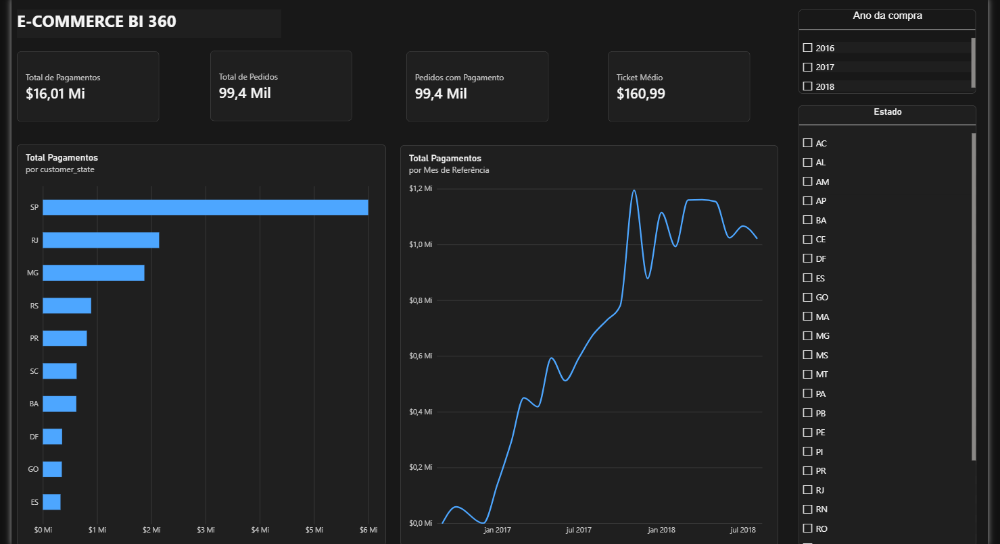

# E-commerce BI 360

Projeto de Engenharia e Análise de Dados desenvolvido para transformar dados brutos de e-commerce em indicadores de negócio e visualizações interativas.

O projeto utiliza Python, Pandas, PostgreSQL, SQL e Power BI para construir um pipeline de tratamento, integração, armazenamento e análise de dados.

## Dashboard



## Objetivo

Desenvolver uma solução de Business Intelligence capaz de analisar o desempenho operacional e financeiro de um e-commerce.

O projeto busca responder perguntas como:

- Qual é o valor total dos pagamentos registrados?
- Quantos pedidos foram realizados?
- Qual é o ticket médio?
- Quais estados concentram os maiores valores de pagamentos?
- Como os pagamentos evoluíram ao longo do tempo?

## Tecnologias utilizadas

- Python
- Pandas
- PostgreSQL
- SQL
- SQLAlchemy
- Power BI
- DAX
- Git e GitHub

## Dataset

Foi utilizado o conjunto de dados público **Brazilian E-Commerce Public Dataset by Olist**, disponibilizado no Kaggle.

O dataset contém informações sobre pedidos, clientes, pagamentos e entregas de um e-commerce brasileiro.

A análise considera aproximadamente 100 mil pedidos registrados entre 2016 e 2018.

## Estrutura do projeto

```text
ecommerce-bi-360/
│
├── dashboards/
│   ├── ecommerce_bi_360.pbix
│   └── preview.png
│
├── data/
│   ├── raw/
│   └── processed/
│
├── src/
│   ├── explorar_dados.py
│   ├── tratar_dados.py
│   ├── cruzar_dados.py
│   ├── gerar_indicadores.py
│   ├── carregar_postgres.py
│   └── validar_postgres.py
│
├── .gitignore
├── README.md
└── requirements.txt
```

Os arquivos CSV originais e processados não são versionados no repositório.

## Pipeline de dados

O processamento foi dividido em seis etapas.

### 1. Exploração dos dados

Arquivo: `explorar_dados.py`

Análise inicial da estrutura dos dados, identificação de valores ausentes, duplicatas e distribuição dos pedidos por status.

### 2. Tratamento dos dados

Arquivo: `tratar_dados.py`

Conversão de datas, verificação de inconsistências e criação de indicadores operacionais relacionados ao prazo de entrega.

### 3. Integração dos dados

Arquivo: `cruzar_dados.py`

Integração das informações de pedidos, clientes e pagamentos utilizando Pandas.

Os pagamentos são agrupados por pedido antes da integração, evitando duplicação de registros e distorções nos indicadores financeiros.

### 4. Geração de indicadores

Arquivo: `gerar_indicadores.py`

Cálculo de indicadores por estado, incluindo:

- Quantidade de pedidos
- Valor total dos pagamentos
- Quantidade de pedidos com pagamento registrado
- Ticket médio

### 5. Armazenamento no PostgreSQL

Arquivo: `carregar_postgres.py`

Carregamento dos dados tratados no banco PostgreSQL, utilizando o schema `analytics`.

Tabelas principais:

- `analytics.pedidos_consolidados`
- `analytics.indicadores_estado`

### 6. Validação dos dados

Arquivo: `validar_postgres.py`

Consultas SQL para verificar a quantidade de registros e a consistência dos valores financeiros armazenados.

## Indicadores obtidos

| Indicador | Resultado |
|---|---:|
| Total de pedidos | 99.441 |
| Pedidos com pagamento registrado | 99.440 |
| Valor total dos pagamentos | R$ 16.008.872,12 |
| Ticket médio | R$ 160,99 |
| Estados analisados | 27 |

O ticket médio considera somente os pedidos com informação de pagamento registrada.

**Importante:** o valor total representa pagamentos associados aos pedidos, independentemente do status. Portanto, não deve ser interpretado como faturamento líquido.

## Dashboard interativo

O dashboard foi desenvolvido no Power BI e oferece:

- Indicadores financeiros e operacionais
- Ranking dos dez estados com maiores valores de pagamentos
- Evolução mensal dos pagamentos
- Filtros interativos por estado e ano

A evolução mensal utiliza a data de compra dos pedidos como referência. Os meses finais incompletos foram excluídos do gráfico temporal para evitar interpretações equivocadas.

## Como executar

### 1. Preparar o ambiente

Instale as dependências:

```bash
pip install -r requirements.txt
```

### 2. Obter os dados

Baixe o dataset público da Olist no Kaggle e coloque os arquivos CSV na pasta:

`data/raw/`

### 3. Executar o pipeline

Execute os scripts na seguinte ordem:

```bash
python src/explorar_dados.py
python src/tratar_dados.py
python src/cruzar_dados.py
python src/gerar_indicadores.py
```

### 4. Configurar o PostgreSQL

Crie um banco de dados chamado `ecommerce_bi` e configure as credenciais em um arquivo `.env` local.

O arquivo `.env` não deve ser enviado ao GitHub.

Após configurar o banco, execute:

```bash
python src/carregar_postgres.py
python src/validar_postgres.py
```

### 5. Abrir o dashboard

O arquivo do Power BI está disponível em:

`dashboards/ecommerce_bi_360.pbix`

Para atualizar os dados, é necessário configurar a conexão com o PostgreSQL local.

## Principais aprendizados

O desenvolvimento deste projeto permitiu aplicar conhecimentos de:

- Exploração e limpeza de dados
- Integração de múltiplas fontes
- Tratamento de inconsistências
- Agregação de registros financeiros
- Validação da integridade dos dados
- Modelagem de indicadores de negócio
- Integração entre Python, PostgreSQL e Power BI
- Criação de dashboards interativos
- Versionamento de projetos com Git

## Próximas melhorias

- Automatização da execução do pipeline
- Implementação de testes automatizados
- Expansão das análises operacionais de entrega
- Aprimoramento da modelagem dos dados
- Inclusão de novas métricas e visualizações